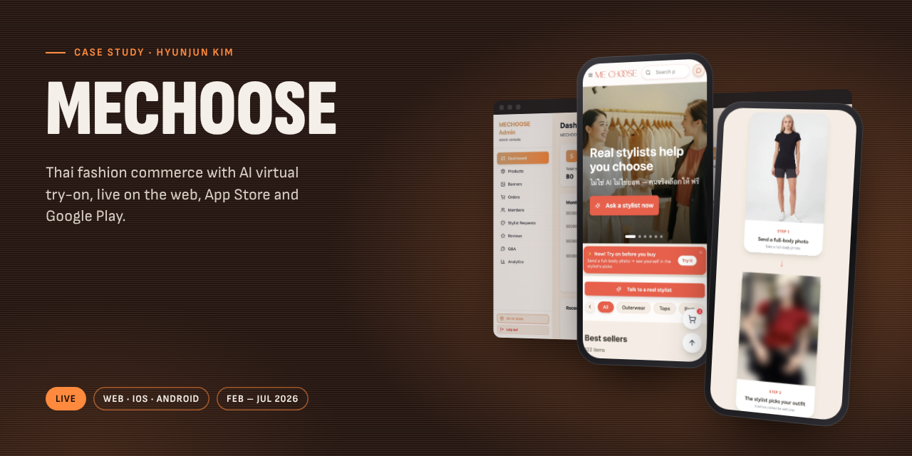
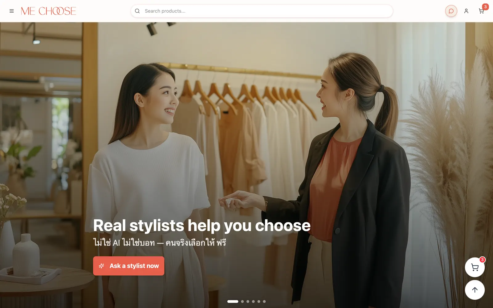
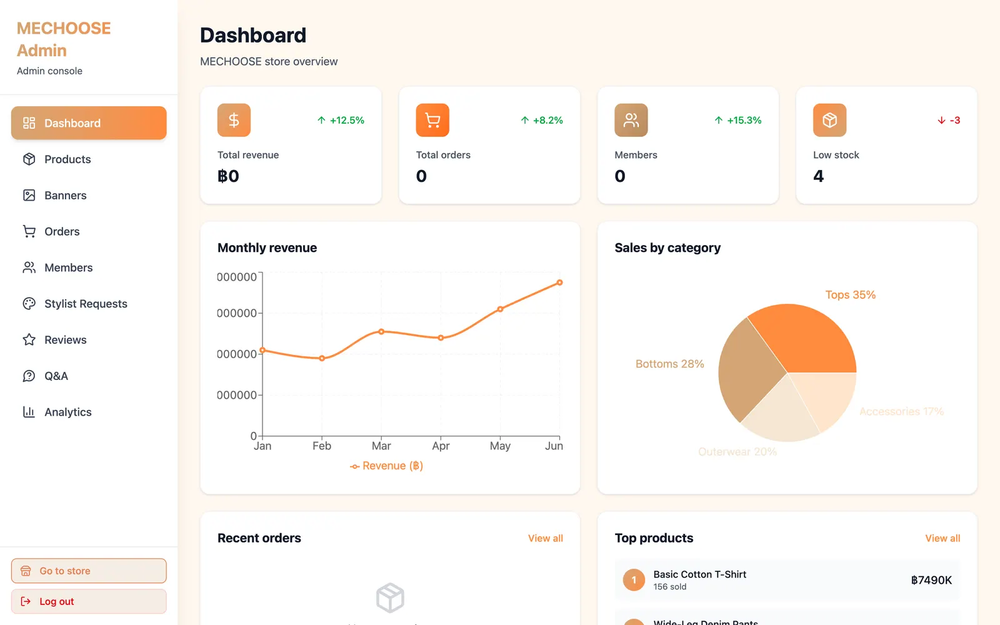
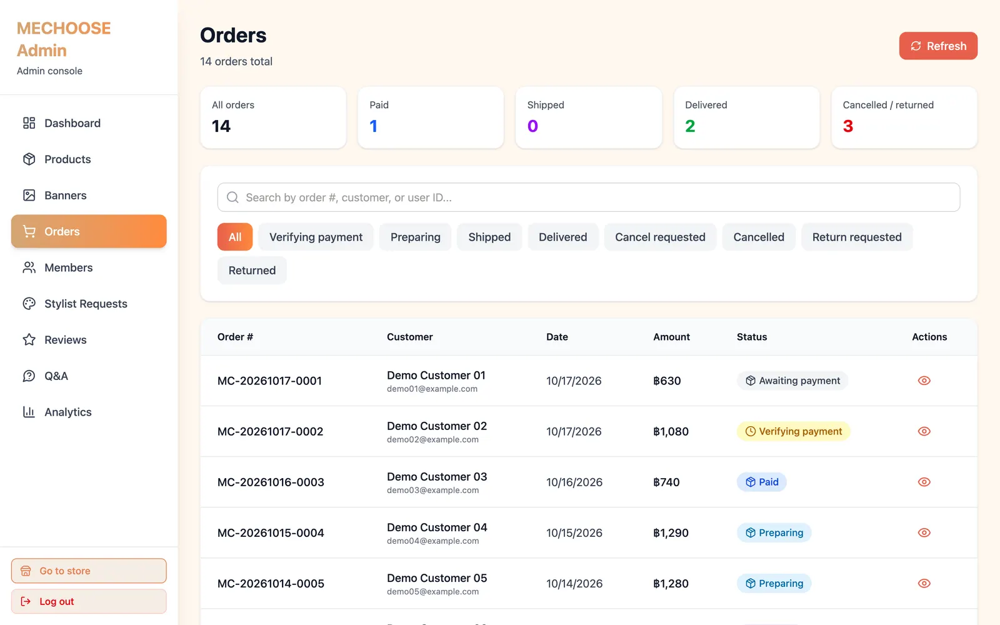
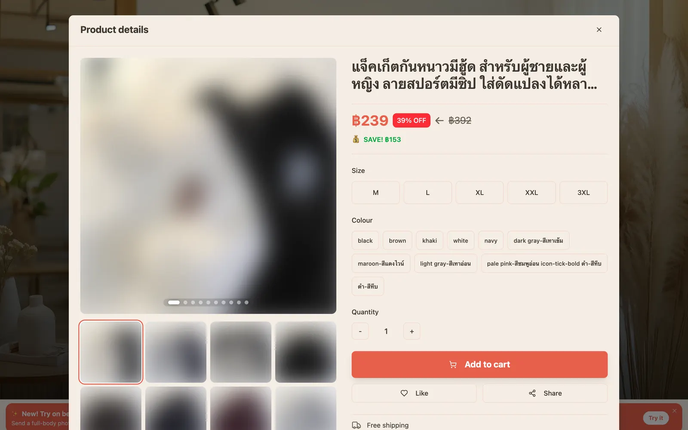
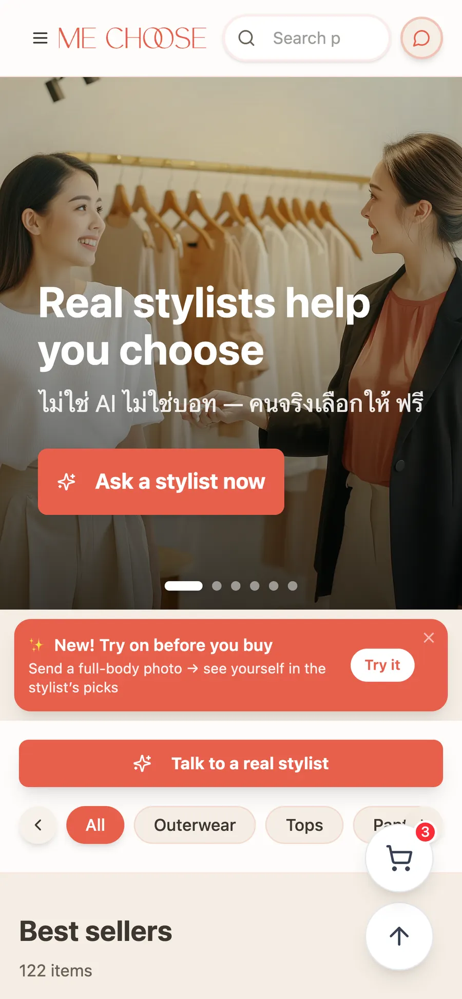
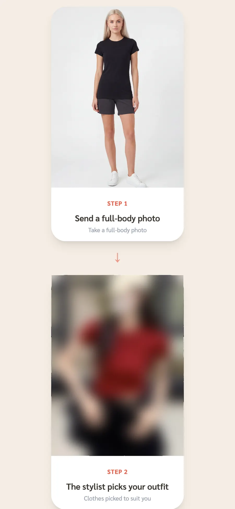
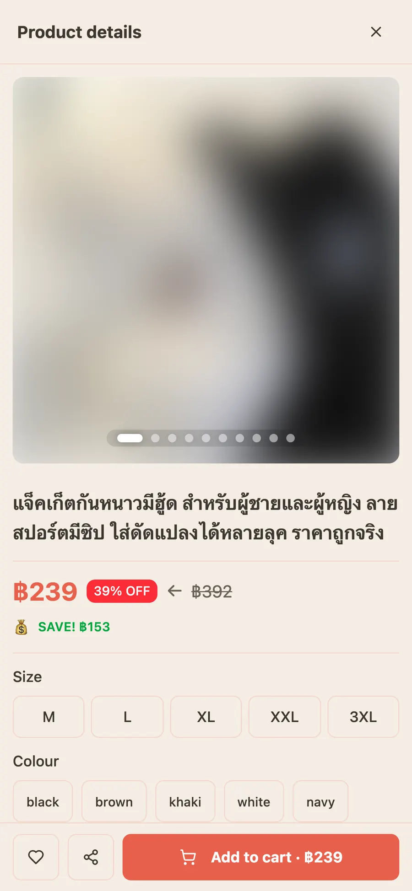
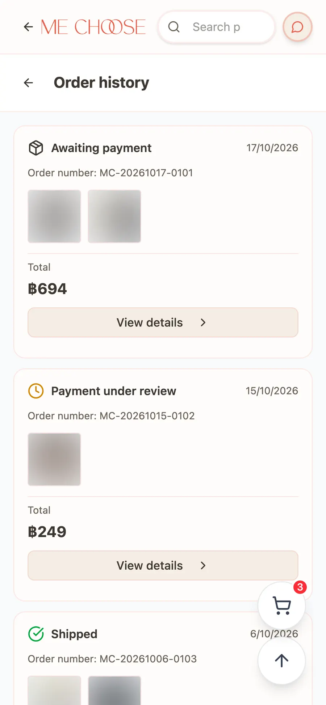
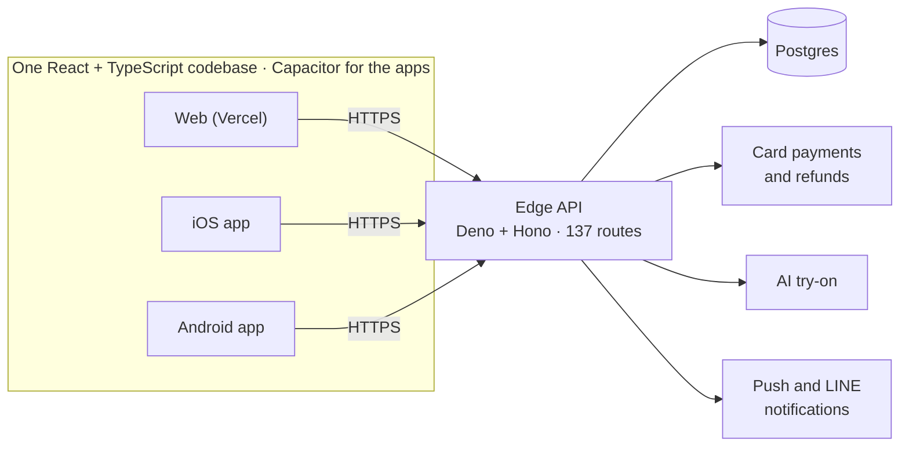

# MECHOOSE

Thai fashion commerce with AI virtual try-on, live on the web, App Store and Google Play.

**Status:** Live &nbsp;·&nbsp; **Platforms:** Web · iOS · Android &nbsp;·&nbsp; **Built:** Feb – Jul 2026
 [Live site](https://mechoose.store) · [App Store](https://apps.apple.com/th/app/id6760345269) · [Google Play](https://play.google.com/store/apps/details?id=store.mechoose.app) · [Full case study](https://hyunjunkim.vercel.app/projects/mechoose/)

> [!NOTE]
> This repository is a **case study**, not the source code. The code is private. I'm happy to walk through the codebase live in an interview, or to give a hiring team temporary read access on request.

## The problem

Thai shoppers had no single place to pick clothes, try them on virtually and order. MECHOOSE puts the full commerce flow (catalog, cart, real card payments, refunds, returns, reviews, admin) next to an AI virtual try-on and a human stylist flow, in one app.

## Screens

|   |   |
|:-:|:-:|
|  |  |
| Web store | Admin dashboard (demo data) |
|  |  |
| Order management (demo data) | Product detail (web) |

|   |   |   |   |
|:-:|:-:|:-:|:-:|
|  |  |  |  |
| App home | AI try-on flow | Product detail | Order history with resumable payment |

## Architecture

## Key decisions

- **One web codebase, three stores.** A solo builder can't maintain three apps. The React app is wrapped with Capacitor for iOS and Android, so one change ships everywhere.
- **Serverless edge API.** All business logic runs as edge functions next to the database. There is no server to patch or scale, which matters when one person is on call.
- **Payment amounts are re-checked on the server.** The app never decides what a customer pays. Prices and totals are recomputed server-side before a charge.
- **Collect delivery details at sign-in, not at checkout.** Missing phone, address or LINE ID used to block orders at the last step. Asking once, up front, removed that drop-off point.
- **Performance budget for the main bundle.** The main bundle went from 1.6 MB to 454 KB: vendor code split into five chunks and the admin app loaded only when needed.

## By the numbers

| | |
|--:|:--|
| **~1 week** | Idea to live web service |
| **~6 weeks** | Idea to App Store approval (also on Google Play) |
| **137** | Backend API routes |
| **~38,600** | Lines of frontend code |

## Problems solved along the way

**Abandoned unpaid orders.** Interrupted payments left orders stranded. A status label alone didn't help, so a pending-payment banner and a resume flow now take the shopper back to the exact step where they stopped.

**Address typos causing failed deliveries.** Hand-typed addresses had frequent errors. Address autocomplete now fills in the postal code automatically.

**Large edits causing regressions.** Rewriting big files in one go broke working features. The working rule became: targeted patches only, side effects explained and approved before any change.

## What's next

- Split the backend by domain (orders, then payments, then admin) and move orders and payments to dedicated tables with migrations.
- Unit tests for payment and order logic first, then build, type check and tests on every commit.
- Strict typing as a release gate, starting with the payment code.

## Stack

`React 18` · `TypeScript` · `Vite` · `Tailwind CSS` · `Supabase (Postgres, Auth, Edge Functions)` · `Deno` · `Hono` · `Capacitor` · `Vercel`

## How it was built

I built this solo, with AI coding agents as my development team. I planned the service scope and screen flow, chose the stack together with AI, directed the agents feature by feature, and verified every release with real purchases on the live site.

More of my work: [portfolio](https://hyunjunkim.vercel.app) · [all case studies](https://github.com/g326555-lab)

---

© 2026 Hyunjun Kim. All rights reserved. See [LICENSE](LICENSE).
